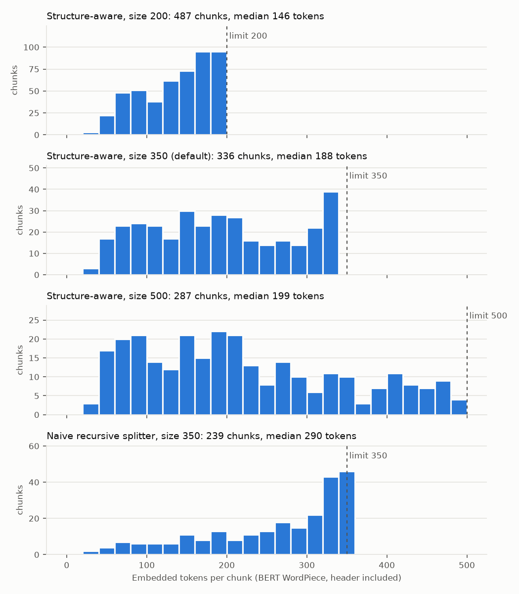
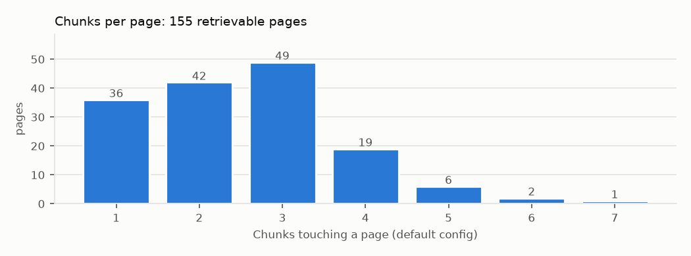

# Chunking and metadata (Step 3)

How `ingestion/chunking.py` turns `data/parsed/pages.jsonl` into retrieval chunks, why the default configuration looks the way it does, and what every metadata field is for. This step also folds in the figure metadata from `ingestion/figures.py`; Step 2 (captions, OCR) was skipped (ADR-0013).

Reproduce:

```bash
uv run python -m ingestion.figures          # data/parsed/figures.jsonl (committed)
uv run python -m ingestion.chunking --grid  # data/chunks/<hash>.jsonl for every config (gitignored, ~6 s)
uv run python -m scripts.plot_chunks        # docs/img/*.png
uv run python -m pytest tests/test_chunking.py
```

## 1. Default configuration

| Setting | Value | Why |
|---|---|---|
| Strategy | structure-aware | The guide is already split into small titled how-to units; follow them. |
| Size | 350 tokens (header + body) | Holds a whole subsection in most cases (median unit is 173 tokens); fits every candidate embedding model, including the 512-token ones. |
| Overlap | 0 | Chunks end at paragraph or section boundaries, not mid-sentence, so overlap mostly duplicates text. 15% overlap stays in the grid for Step 10. |
| Header prefix | on | "iPhone User Guide > Chapter 3: Basics > Use apps > Multitasking" is embedded with the text. Short chunks don't name their own topic; the header does. |
| Figure mode | `labels` | Diagram callout labels are real document text (ADR-0011). `none` stays in the grid. |
| Min size | 64 tokens | A subsection only starts a new chunk once the current one holds at least this much; tiny units merge forward. |

Config hash: `edb94b731b`, giving 336 chunks and 64,001 embedded tokens.

**This is a starting point, not a conclusion.** Every alternative in the grid below is built and will be compared on page-level retrieval metrics in Step 10. The defaults change if the evidence says so.

## 2. Why this document wants structure-aware chunking

Measurements from Step 1 (BERT tokens):

| Unit | Median | p90 | Max |
|---|---|---|---|
| Element (paragraph, list item, table row) | 24 | 61 | 188 |
| Subsection (leaf unit) | 173 | 413 | 1,417 |
| Section | 175 | 467 | 6,219 (VoiceOver) |

- **Units are short and self-contained.** 747 of 1,914 paragraphs are task paragraphs opening with a bold lead-in ("Close an app. Drag the app up…"). A good chunk is "one subsection": a few related tasks under one heading.
- **Answers are local.** Most questions are answered by one task paragraph on one page. Small chunks keep the cited page precise.
- **Context lives in headings, not in the text.** "Drag the app up from the multitasking display" never says "Basics" or "Multitasking". That's why the header path is embedded.
- **Cross-references are explicit** ("See Search on page 30"), so the model doesn't need large chunks to see related material; Step 10 can test pulling in the referenced section.

## 3. The strategy

**Structure-aware** packs whole parsed elements into chunks:

1. Chapters and sections (the TOC level) are **hard boundaries**. A chunk never spans two chapters (tested on every config).
2. A subsection is a **soft boundary**: it starts a new chunk only if the current chunk already has `min_size` tokens.
3. Within a unit, elements are added until the next one would exceed `size`. If an element alone exceeds it (only at size 200: three 184–188-token paragraphs), the recursive splitter cuts it at sentence boundaries into `partial` chunks.
4. **Size splits are repaired:**
   - a chunk never ends on an intro line ending in ":" ("…set the following:"); it moves to the chunk with the list it introduces;
   - a continued table repeats its column names once;
   - a tiny last piece is rebalanced by moving paragraphs from the previous piece. In the default config this took chunks under 64 tokens from 37 to 26; the rest are genuinely short units;
   - with overlap > 0, trailing elements up to `overlap` tokens are repeated, never across a section boundary.
5. Headings alone never form a chunk; they join their content.
6. A chunk may span a page break when its section does: 56 chunks in the default config. All of its pages are listed in `pages` and cited.

**Naive baseline:** LangChain's `RecursiveCharacterTextSplitter` (token length, size 350, overlap 50) over the concatenated text, with no header. Metadata is recovered from character offsets. It produces 7 chunks that span two chapters. Note: LangChain's `add_start_index` subtracts the token-unit overlap from a character offset, which misplaced chunks. Offsets are now located manually (tested: every element is covered).

**Token unit.** BERT WordPiece with the bert-base-uncased vocabulary, committed under `ingestion/assets/` so chunking is offline and deterministic. That's the tokenizer of the strictest candidates (BGE, E5, GTE: 512 tokens). Long-context models (Qwen3, Nemotron) tokenize English to a similar or smaller count. Step 4 checks the real per-model counts against `usage.prompt_tokens` returned by the embeddings API.

## 4. The grid

The brief's starting grid was 300/500/800 tokens. **800 was dropped**: BGE, E5 and GTE truncate at 512 tokens, so an 800-token chunk would be silently cut for half the candidates and the benchmark would compare different texts. The grid is **200/350/500**, crossed with overlap 0 or 15% and header on or off, plus `figure_mode=none` and the naive baseline.

| Hash | Strategy | Size | Overlap | Header | Figures | Chunks | p50 | p90 | Max | Multi-page | Cross-chapter | Tokens total |
|---|---|---|---|---|---|---|---|---|---|---|---|---|
| `da9554ceeb` | structure | 200 | 0 | yes | labels | 487 | 146 | 186 | 198 | 48 | 0 | 66,210 |
| `794ad47a8f` | structure | 200 | 0 | no | labels | 451 | 141 | 186 | 197 | 51 | 0 | 59,316 |
| `22ea4c7b87` | structure | 200 | 30 | yes | labels | 497 | 152 | 188 | 198 | 55 | 0 | 68,559 |
| `f0e9fd210b` | structure | 200 | 30 | no | labels | 458 | 151 | 187 | 197 | 58 | 0 | 61,243 |
| **`edb94b731b`** | **structure** | **350** | **0** | **yes** | **labels** | **336** | **188** | **322** | **339** | **56** | **0** | **64,001** |
| `3e97055b11` | structure | 350 | 0 | no | labels | 323 | 177 | 322 | 340 | 56 | 0 | 59,304 |
| `5cb1f270c6` | structure | 350 | 52 | yes | labels | 339 | 189 | 324 | 339 | 62 | 0 | 66,105 |
| `d3d4691e01` | structure | 350 | 52 | no | labels | 326 | 179 | 325 | 346 | 60 | 0 | 60,958 |
| `dab45fff21` | structure | 500 | 0 | yes | labels | 287 | 199 | 416 | 484 | 61 | 0 | 63,306 |
| `15d79b8493` | structure | 500 | 0 | no | labels | 283 | 182 | 412 | 484 | 56 | 0 | 59,292 |
| `58a4e1c4f9` | structure | 500 | 75 | yes | labels | 290 | 196 | 427 | 484 | 61 | 0 | 64,726 |
| `8de742da85` | structure | 500 | 75 | no | labels | 285 | 180 | 417 | 486 | 59 | 0 | 60,318 |
| `88a6d933bb` | structure | 350 | 0 | yes | none | 333 | 179 | 321 | 339 | 56 | 0 | 62,105 |
| `76da0171b7` | naive | 350 | 50 | no | labels | 239 | 290 | 346 | 350 | 9 | 7 | 61,657 |

What the table already shows:
- **Overlap barely matters for structure-aware chunks.** It adds 3 chunks at size 350, because most chunks close at a heading, where nothing is carried over.
- **The header costs about 8% more tokens** (64.0k vs 59.3k), which is negligible: each model embeds roughly 60–70k tokens.
- **Medians grow far more slowly than the size limit** (146, then 188, then 199 tokens), because most units are smaller than the limit. Going from 350 to 500 only changes how long sections are split.



The structure-aware panels show a broad spread of natural unit sizes plus a bump just under the limit, where long sections are split. The naive splitter piles almost everything up at the limit, cutting through tasks and headings.



Most pages are covered by 1–3 chunks. The 7-chunk page is dense with short subsections.

## 5. Examples

**Good: one subsection, one chunk, with its figure** (p. 22, 141 tokens, `figure_ids=["p022-f1"]`):

```
iPhone User Guide > Chapter 3: Basics > Use apps > Multitasking
Multitasking
iPhone lets you run many apps at the same time.
View your running apps. Double-click the Home button to reveal the multitasking display. ...
Close an app. If an app isn't working properly, you can force it to quit. Drag the app up ...
If you have lots of apps, you can use Spotlight ... See Search on page 30.
```

**Good: a diagram becomes searchable** (pp. 8–9, `figure_ids=["p008-f1", "p008-f2"]`):

```
iPhone User Guide > Chapter 1: iPhone at a Glance > iPhone overview
...
iPhone 5s
Figure labels: FaceTime camera; Receiver/front microphone; Ring/Silent switch; Volume buttons; ...
```

**Good: a continued table keeps its column names** (pp. 12–13): "Status icon | What it means" opens the second chunk exactly once.

**Weak but acceptable: a tiny unit** (p. 14, 28 tokens). The chapter intro of "Getting Started" is a single warning. It stays separate rather than being glued to an unrelated section; the header supplies context. There are 26 chunks under 64 tokens, all genuinely short units.

**Bad (baseline): the naive splitter crosses a chapter** (pp. 20–21). One chunk ends Chapter 2 ("…see Chapter 30, iBooks, on page 118.") and starts Chapter 3 ("Basics / Use apps / All the apps that come with iPhone…"). Its embedding mixes two topics, and its section metadata can only name one of them.

## 6. Chunk metadata (Qdrant payload)

| Field | Example | Why it exists |
|---|---|---|
| `chunk_id` | UUIDv5 | Deterministic point id (hash of config, page and embedded text), so re-ingesting is idempotent. |
| `chunk_config_hash` | `edb94b731b` | Ties a vector to the exact config, chunker version and parser version; part of the collection name. |
| `source`, `doc_version` | `iPhone_User_Guide_1.pdf`, `iOS 7.1 …, 019-2617/2014-03` | Provenance; the part number is printed on the last page. |
| `page`, `pdf_page_index` | 22, 21 | Citation page (= printed page) and 0-based index for rendering the page in the UI. |
| `page_start`, `page_end`, `pages` | 12, 13, [12, 13] | Chunks spanning a page break cite every page they touch. |
| `chapter_number`, `chapter_title` | "3", "Basics" | Citation text; payload filter (e.g. restrict to an appendix). |
| `section_title`, `subsection_titles`, `section_path` | "Use apps", ["Multitasking"] | The "Section" shown in citations, and the source of the contextual header. |
| `content_type` | text / table / legal | Lets the UI and evaluation treat tables and legal text differently. TOC and front matter are never chunked. |
| `lead_ins` | ["Close an app."] | Task titles in the chunk: cheap keyword anchors for hybrid search, and a readable citation label. |
| `has_figure`, `figure_ids` | true, ["p022-f1"] | Folded-in figure metadata: the UI can show the figure region, and evaluation can slice by figure-dependent questions. |
| `xrefs` | [{label: "Search", target_page: 30, …}] | Lets Step 10 try "follow the cross-reference" retrieval. |
| `header`, `text`, `embed_text` | | `embed_text` is what's embedded (header + text); `text` is what the user sees, without the synthetic header. |
| `char_count`, `token_count`, `embed_token_count` | 520, 128, 141 | Budget checks against model limits; distribution reporting. |
| `element_refs` | [[22, 3], [22, 4]] | Traceability back to `pages.jsonl` (tests use it to prove nothing is lost or duplicated). |
| `partial` | false | Marks pieces of an element that had to be split (size 200 only). |
| `embedding_model`, `ingested_at` | | Added at ingestion time (Step 4). |

Deviations from the brief's field list:
- `figure_caption` and `figure_ocr_text` are absent, because no captions or OCR are produced (ADR-0013).
- `content_type` uses `text | table | legal`. Figures aren't separate chunks: their labels are inline text, and `has_figure` marks them.
- `subsection_titles` is a list, because the soft boundary can merge a tiny subsection into the next one (2 chunks in the default config).

## 7. Figure metadata (folded-in Step 2)

`data/parsed/figures.jsonl` has one record per figure region:
- **Regions, not image objects.** Image placements within 8 pt of each other are merged, then regions illustrating the same instruction are unioned, so p. 8's 88 image slices become 2 figures. That gives 153 regions: 122 kept, plus 28 chapter-opener app icons and 3 tiny icons dropped.
- **Anchor text** is the text element just above the figure: the de facto caption, since the guide prints none. All 122 kept figures have one.
- **Labels:** 73 of 74 callout-label groups attach to a figure, either by overlap or because they directly follow the anchor.
- **Duplicates:** none. All renderings are distinct (checked by content hash).

Chunks get `figure_ids` from the anchor element they contain: 102 of 336 chunks have at least one figure.
